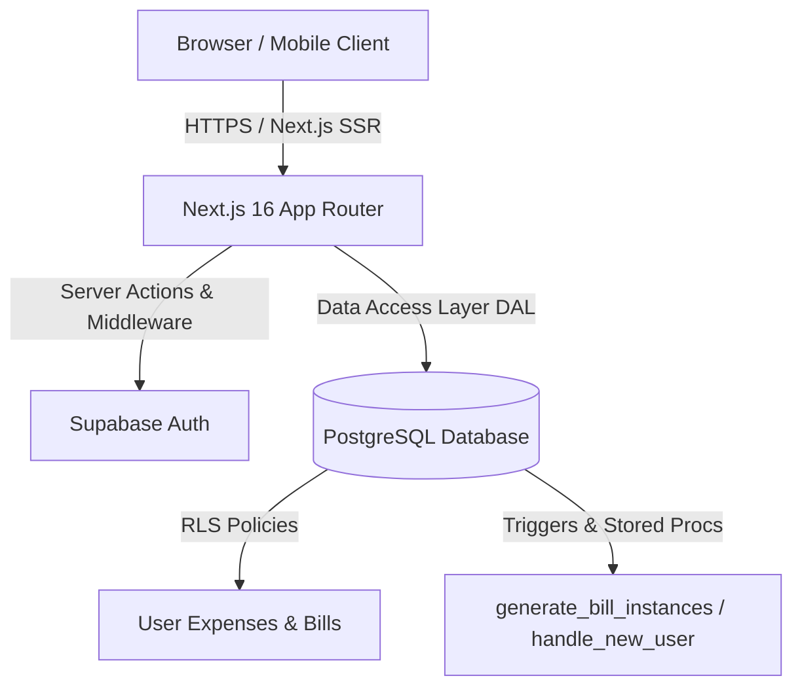

# 💰 BudgetBuddy

> A modern, intuitive personal finance and subscription tracking application built with **Next.js 16 (App Router)**, **React 19**, **Supabase**, and **Tailwind CSS v4**.


---

## 📖 Table of Contents

- [Overview](#-overview)
- [Key Features](#-key-features)
- [Architecture & Tech Stack](#-architecture--tech-stack)
- [Database Schema & Security](#-database-schema--security)
- [Project Structure](#-project-structure)
- [Getting Started](#-getting-started)
  - [Prerequisites](#prerequisites)
  - [Installation](#installation)
  - [Environment Configuration](#environment-configuration)
  - [Database Setup](#database-setup)
  - [Running the App](#running-the-app)
- [Application Routes](#-application-routes)
- [Available Scripts](#-available-scripts)
- [Contributing](#-contributing)
- [License](#-license)

---

## 🌟 Overview

**BudgetBuddy** is a full-featured personal finance tracker designed to provide clarity and control over daily expenses and recurring bills. Whether tracking coffee purchases, analyzing monthly groceries, or managing multi-frequency recurring bills (utilities, subscriptions, rent), BudgetBuddy combines modern UI aesthetics with resilient backend data isolation via Supabase Row Level Security (RLS).

### Core Highlights
- **Real-Time Financial Dashboard**: Bento-grid layout showing monthly commitments, spent totals, upcoming bills, and dynamic category breakdowns.
- **Automated Recurring Bills**: Intelligent recurrence engine that calculates due dates, tracks payment completion, and projects upcoming dues.
- **Interactive 30-Day Due Timeline**: Visual calendar strip to preview and mark bill instances as paid or unpaid with one click.
- **Customizable Theming**: Full Light and Dark mode support coupled with 5 accent color themes (*Emerald*, *Ocean*, *Sunset*, *Royal*, *Rose*).
- **Responsive Experience**: Optimized for mobile and desktop with an adaptive side rail on widescreen and a floating bottom tab bar on mobile.

---

## ✨ Key Features

### 📊 1. Comprehensive Financial Dashboard
- **Personalized Greeting**: Time-aware greeting based on the user's localized time.
- **This Month's Total Card**: Big-number typography breaking down total monthly commitments, actual money spent, and pending bills.
- **Quick Add Trigger**: Instant in-place expense logger directly from the dashboard.
- **Category Spending Distribution**: Visual progress bars highlighting top spending categories with percentage allocations.
- **Upcoming Bills Preview**: Quick glimpse at the most urgent pending commitments.

### 💳 2. Expense Tracking & Management
- **Full CRUD Lifecycle**: Add, update, view, and delete expenses with instantaneous UI updates and path revalidation.
- **Multi-Filter Engine**:
  - Filter by date range: *This Month*, *Last Month*, *All Time*, or *Custom Date Range*.
  - Filter by category: Food & Dining, Transport, Housing, Utilities, Entertainment, Healthcare, Education, Shopping, Subscriptions, and Other.
- **Live Summary**: Real-time sum calculation based on currently applied filters.
- **Strict Validation**: Powered by Zod schemas validating amounts, categories, and calendar dates.

### 🔁 3. Recurring Bills & Subscription Lifecycle
- **Flexible Recurrence Frequencies**: Support for `daily`, `weekly`, `biweekly`, `monthly`, `quarterly`, and `yearly` cycles with customizable intervals (e.g., every 2 weeks, every 3 months).
- **Finite or Infinite Recurrence**: Track subscriptions that repeat indefinitely or auto-expire after a specified repetition count.
- **PostgreSQL Instance Generator**: Database-level function (`generate_bill_instances`) that computes concrete payment instances into `recurring_bill_instances`.
- **Payment Status Toggle**: One-click toggle between paid and unpaid statuses with timestamped payment history (`paid_at`).
- **Interactive 30-Day Timeline**: Horizontal timeline spanning 3 days in the past, today, and 26 days forward to monitor payment schedules.

### 🎨 4. Theme & Appearance Personalization
- **Dark & Light Mode**: Seamless theme switching using CSS variables and HTML `data-theme` attributes.
- **5 Curated Color Accents**:
  - 🟢 **Emerald**: Fresh green finance aesthetic (Default).
  - 🔵 **Ocean**: Crisp blue corporate tone.
  - 🟠 **Sunset**: Energetic warm orange.
  - 🟣 **Royal**: Elegant purple accent.
  - 🔴 **Rose**: Vibrant crimson tone.
- **Local Persistence**: Remembers theme mode and accent color choices via `localStorage`.

### 🔒 5. Enterprise-Grade Security & Auth
- **Supabase Authentication**: Secure session handling with Email/Password and Google OAuth.
- **Next.js Middleware Session Refresh**: Cookie-based server-side session refreshing via `@supabase/ssr`.
- **Row Level Security (RLS)**: Strict PostgreSQL security policies ensuring users can only read, insert, update, and delete their own records.
- **Automated Profile Provisioning**: Database trigger (`handle_new_user`) that creates a `profiles` entry whenever a new user signs up.

---

## 🛠 Architecture & Tech Stack



| Layer | Technology | Details |
| :--- | :--- | :--- |
| **Framework** | [Next.js 16](https://nextjs.org/) | App Router, Server Actions, Server Components, Route Handlers |
| **Frontend UI** | [React 19](https://react.dev/) | React Server Components (RSC) and client-side interactivity |
| **Styling** | [Tailwind CSS v4](https://tailwindcss.com/) | CSS variables-driven tokens, inline theme configurations |
| **Motion** | [Framer Motion](https://www.framer.com/motion/) | Smooth modal transitions and timeline animations |
| **Icons** | [Lucide React](https://lucide.dev/) | Modern, lightweight SVG iconography |
| **Database & Auth** | [Supabase](https://supabase.com/) | PostgreSQL, Auth, Row Level Security (RLS), PL/pgSQL functions |
| **Validation** | [Zod](https://zod.dev/) | Type-safe schema validation on client and server |
| **Dates** | [date-fns](https://date-fns.org/) | Date arithmetic, window generation, and timezone formatting |
| **Language** | [TypeScript](https://www.typescriptlang.org/) | Strict type checking across database models and components |

---

## 🗄 Database Schema & Security

The database schema is defined in [`supabase/migrations/001_initial_schema.sql`](file:///Users/mba/Desktop/BudgetBuddy/BudgetBuddy/supabase/migrations/001_initial_schema.sql).

### Entity Relationship Model

```
profiles
├── id (UUID, PK -> auth.users.id)
├── display_name (TEXT)
├── avatar_url (TEXT)
├── preferred_currency (TEXT, default 'USD' / 'PHP')
└── created_at (TIMESTAMPTZ)
     │
     ├──< expenses
     │    ├── id (UUID, PK)
     │    ├── user_id (UUID, FK -> profiles.id)
     │    ├── title (TEXT)
     │    ├── amount (NUMERIC(12, 2))
     │    ├── category (expense_category ENUM)
     │    ├── expense_date (DATE)
     │    └── notes (TEXT)
     │
     └──< recurring_bills
          ├── id (UUID, PK)
          ├── user_id (UUID, FK -> profiles.id)
          ├── title (TEXT)
          ├── amount (NUMERIC(12, 2))
          ├── category (expense_category ENUM)
          ├── frequency (bill_frequency ENUM)
          ├── interval_value (INT)
          ├── start_date (DATE)
          ├── total_repetitions (INT, NULL = infinite)
          ├── repetitions_completed (INT)
          ├── is_active (BOOLEAN)
          └── notes (TEXT)
               │
               └──< recurring_bill_instances
                    ├── id (UUID, PK)
                    ├── bill_id (UUID, FK -> recurring_bills.id)
                    ├── user_id (UUID, FK -> profiles.id)
                    ├── due_date (DATE)
                    ├── amount (NUMERIC(12, 2))
                    ├── is_paid (BOOLEAN)
                    └── paid_at (TIMESTAMPTZ)
```

### Stored Procedures & Triggers
- **`handle_new_user()`**: Trigger on `auth.users` insertion to automatically create a corresponding `profiles` row.
- **`generate_bill_instances(p_bill_id UUID, p_count INT)`**: Automatically calculates future payment schedules according to the specified frequency and interval.
- **Row Level Security**: Explicit policies enforce that `auth.uid() = user_id` across `SELECT`, `INSERT`, `UPDATE`, and `DELETE`.

---

## 📁 Project Structure

```text
BudgetBuddy/
├── docs/                                # Technical setup guides
│   └── SUPABASE_AUTH_SETUP.md           # Supabase Auth & Google OAuth guide
├── public/                              # Static public assets
├── src/
│   ├── app/                             # Next.js App Router
│   │   ├── auth/
│   │   │   └── callback/route.ts        # OAuth exchange callback handler
│   │   ├── dashboard/
│   │   │   ├── bills/                   # Recurring bills page & server actions
│   │   │   │   ├── actions.ts           # Bill CRUD & pay/unpay actions
│   │   │   │   └── page.tsx
│   │   │   ├── expenses/                # Expenses page & server actions
│   │   │   │   ├── actions.ts           # Expense CRUD server actions
│   │   │   │   └── page.tsx
│   │   │   ├── settings/                # User preferences & account settings
│   │   │   │   └── page.tsx
│   │   │   ├── error.tsx                # Dashboard error boundary
│   │   │   ├── layout.tsx               # AppShell wrapper with auth check
│   │   │   └── page.tsx                 # Main dashboard bento grid
│   │   ├── login/                       # Authentication (Sign In & Sign Up)
│   │   │   ├── actions.ts               # Sign in, sign up, sign out actions
│   │   │   └── page.tsx                 # Login UI with OAuth & email form
│   │   ├── globals.css                  # Tailwind v4 theme & CSS custom variables
│   │   ├── layout.tsx                   # Root HTML layout with ThemeProvider
│   │   └── page.tsx                     # Root page (redirects to /dashboard)
│   ├── components/                      # Modular UI components
│   │   ├── bills/                       # Bill management components
│   │   │   ├── bill-card.tsx            # Bill card with frequency badge & actions
│   │   │   ├── bill-form.tsx            # Add/Edit bill modal dialog
│   │   │   ├── bills-view.tsx           # Bills overview & filter controls
│   │   │   └── upcoming-timeline.tsx    # 30-day interactive calendar timeline
│   │   ├── dashboard/                   # Dashboard widgets
│   │   │   └── dashboard-quick-add.tsx  # Quick expense addition trigger
│   │   ├── expenses/                    # Expense tracking components
│   │   │   ├── expense-card.tsx         # Expense item card
│   │   │   ├── expense-form.tsx         # Expense add/edit modal form
│   │   │   └── expenses-view.tsx        # Expense list, filters, and stats
│   │   ├── nav/                         # Navigation system
│   │   │   ├── app-shell.tsx            # Desktop side rail & mobile tab wrapper
│   │   │   ├── bottom-tab-bar.tsx       # Floating mobile bottom navigation
│   │   │   ├── side-rail.tsx            # Desktop left sidebar with tooltips
│   │   │   └── theme-toggle.tsx         # Quick dark/light toggle button
│   │   ├── settings/                    # Settings view
│   │   │   └── settings-view.tsx        # Accent picker, dark mode, sign out
│   │   └── ui/                          # Design system primitives (Button, Card)
│   ├── lib/
│   │   ├── constants/
│   │   │   └── categories.ts            # Category metadata, colors, and formatters
│   │   ├── data/                        # Data Access Layer (DAL)
│   │   │   ├── expenses.ts              # Queries: totals, category breakdowns, CRUD
│   │   │   └── recurring-bills.ts       # Queries: upcoming instances, bills CRUD
│   │   ├── hooks/                       # Custom React hooks (e.g., useMounted)
│   │   ├── supabase/                    # Supabase SSR clients
│   │   │   ├── client.ts                # Browser client
│   │   │   ├── middleware.ts            # Session refresh middleware helper
│   │   │   └── server.ts                # Server component & action client
│   │   ├── theme/                       # Theming system
│   │   │   ├── colors.ts                # Color palettes for accents
│   │   │   ├── theme-provider.tsx       # ThemeContext and DOM variable injector
│   │   │   └── use-theme.ts             # useTheme hook
│   │   ├── validations/                 # Zod validation schemas
│   │   │   └── expense.ts               # Expense form validator
│   │   ├── auth.ts                      # getUser & requireUser session helpers
│   │   └── utils.ts                     # cn utility (clsx + twMerge)
│   ├── proxy.ts                         # Next.js request matcher for session refresh
│   └── types/
│       └── database.ts                  # TypeScript definitions for Supabase entities
├── supabase/
│   └── migrations/
│       └── 001_initial_schema.sql       # PostgreSQL initial migration
├── .env.local.example                   # Example environment variables
├── package.json
├── tsconfig.json
└── README.md
```

---

## 🚀 Getting Started

Follow these steps to set up and run BudgetBuddy locally.

### Prerequisites
- **Node.js**: `v18.18.0` or higher (Node 20+ recommended)
- **Package Manager**: `npm`, `pnpm`, `yarn`, or `bun`
- **Supabase Account**: A free Supabase project from [supabase.com](https://supabase.com)

---

### Installation

1. **Clone the repository:**
   ```bash
   git clone https://github.com/Deng1130/BudgetBuddy.git
   cd BudgetBuddy
   ```

2. **Install project dependencies:**
   ```bash
   npm install
   ```

---

### Environment Configuration

Create a `.env.local` file in the root directory by copying the sample template:

```bash
cp .env.local.example .env.local
```

Populate the following environment variables:

```env
# Supabase Configuration
NEXT_PUBLIC_SUPABASE_URL=https://your-project-id.supabase.co
NEXT_PUBLIC_SUPABASE_ANON_KEY=your-supabase-anon-key-here

# Application URL (Used for auth redirects)
NEXT_PUBLIC_SITE_URL=http://localhost:3000
```

> **Note:** Retrieve your Supabase URL and Anon Key from your Supabase Dashboard under **Project Settings** → **API**.

---

### Database Setup

1. Open your [Supabase Project Dashboard](https://supabase.com/dashboard).
2. Navigate to the **SQL Editor** in the left sidebar.
3. Open [`supabase/migrations/001_initial_schema.sql`](file:///Users/mba/Desktop/BudgetBuddy/BudgetBuddy/supabase/migrations/001_initial_schema.sql) in this repository, copy its entire content, and paste it into the SQL Editor.
4. Click **Run** to execute the script. This will create:
   - Enums (`bill_frequency`, `expense_category`)
   - Tables (`profiles`, `expenses`, `recurring_bills`, `recurring_bill_instances`)
   - Row Level Security (RLS) policies
   - Stored procedure `generate_bill_instances`
   - User creation trigger `handle_new_user`
5. Refer to [`docs/SUPABASE_AUTH_SETUP.md`](file:///Users/mba/Desktop/BudgetBuddy/BudgetBuddy/docs/SUPABASE_AUTH_SETUP.md) for configuring Email Auth and optional Google OAuth credentials.

---

### Running the App

Start the Next.js local development server:

```bash
npm run dev
```

Open [http://localhost:3000](http://localhost:3000) in your browser. You will be redirected to `/dashboard` (or `/login` if unauthenticated).

---

## 🗺 Application Routes

| Path | Access | Description |
| :--- | :--- | :--- |
| `/` | Public | Automatic redirect to `/dashboard`. |
| `/login` | Public | User authentication screen (Sign In, Sign Up, Google OAuth). |
| `/auth/callback` | Public | Route handler resolving OAuth authorization codes. |
| `/dashboard` | Authenticated | Main Bento-grid dashboard with spend summary, quick add, and trends. |
| `/dashboard/expenses` | Authenticated | Expense management with full filtering, editing, and deletion. |
| `/dashboard/bills` | Authenticated | Recurring bills management with 30-day upcoming timeline and payment toggles. |
| `/dashboard/settings` | Authenticated | Appearance customization (Dark/Light mode, Accent color) and sign out. |

---

## 📜 Available Scripts

| Command | Action |
| :--- | :--- |
| `npm run dev` | Starts the Next.js development server at `http://localhost:3000` |
| `npm run build` | Compiles and builds the production application |
| `npm run start` | Launches the built production server |
| `npm run lint` | Runs ESLint checks across the repository |
| `npx tsc --noEmit` | Runs TypeScript compiler to verify static types without emitting output |

---

## 🤝 Contributing

Contributions, issues, and feature requests are welcome!
1. Fork the Project.
2. Create your Feature Branch (`git checkout -b feature/AmazingFeature`).
3. Commit your Changes (`git commit -m 'feat: add some AmazingFeature'`).
4. Push to the Branch (`git push origin feature/AmazingFeature`).
5. Open a Pull Request.

---

## 📄 License

This project is licensed under the MIT License - feel free to customize and expand it for personal or organizational use.
